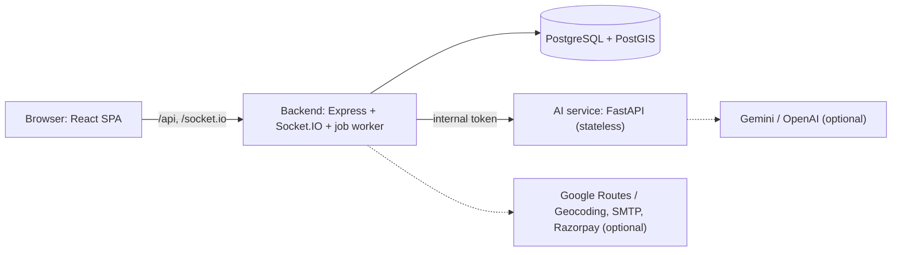

# FoodBridge AI

### Predict. Match. Redistribute.

FoodBridge AI is an intelligent food-redistribution platform for **India**. It connects restaurants, hotels, caterers and
other food businesses that have surplus food with verified NGOs that feed people, and makes sure the food actually
reaches them.

- **Donors** list surplus food for free and earn recognition points.
- **NGOs** post real requirements, collect food through authorised representatives, and pay a transparent service fee.
- **FoodBridge** predicts surplus, matches both sides with explainable rankings, verifies every collection with a QR pass,
  a photo-ID check and a two-way handover, tracks the trip, and measures the impact.

> Status: complete and runnable locally. Every module is implemented and tested.
> See [docs/IMPLEMENTATION_PROGRESS.md](docs/IMPLEMENTATION_PROGRESS.md) and [docs/TESTING_REPORT.md](docs/TESTING_REPORT.md).

---

## Problem and vision

Good food is thrown away at the end of service while NGOs struggle to source meals at the right time and place. Informal
coordination (calls, messaging groups) does not know who needs what or where, promises food twice, cannot verify collectors,
and measures nothing. FoodBridge turns this into a reliable, verifiable and measurable system that anyone in India can use.

## Features

| Area | What it does |
|---|---|
| **Two-way discovery** | Donor-initiated listings **and** NGO-initiated assistance requests ("150 vegetarian meals tomorrow 12–2 PM"). Several donors can fill one request (partial fulfilment) |
| **Explainable matching** | Hard eligibility filters (PostGIS radius, category, diet, capacity, deadline, availability) plus deterministic weighted ranking over 8 criteria, each with an explanation and its limitations. If the AI service is down, a labelled distance-ordered fallback is used |
| **AI surplus forecasting** | A scikit-learn model trained on clearly labelled synthetic data; it beat its baseline on a chronological test split. It never turns a forecast into a donation |
| **Allocation and route optimisation** | OR-Tools: splitting food across NGOs and offers, plus multi-stop collection routes with time windows and vehicle capacity (VRPTW). Infeasible stops are explained |
| **Integrity** | Atomic reservations (no over-allocation, even under concurrency), idempotent submissions, state machines, immutable ledgers and a full audit trail |
| **Pickup verification** | Single-use opaque QR pass scanned by the donor, the donor's photo-ID check of the representative, and two-way quantity confirmation. Mismatches become disputes |
| **LiveTrack** | Consent-based browser GPS for both legs, with Socket.IO updates. Stale positions are labelled, the ETA appears only with road data, and raw GPS points are purged after 30 days |
| **Rewards** | 10 points per verified meal (15 after 500 lifetime meals), 10 points per verified packet or box order. Tiers, leaderboard and PDF certificates |
| **NGO billing** | ₹5 per verified meal, packet or box, shown before commitment and charged only after a verified handover. Configurable GST, invoices (PDF), Razorpay (when configured) and manual payments |
| **AI assistant** | An LLM (Gemini/OpenAI adapter) that can only use the signed-in user's authorised tools; state changes need confirmation. Falls back to direct answers when the LLM is unavailable |
| **Notifications** | In-app plus real-time sockets plus email with retries. Deduplicated and frequency-limited |
| **Analytics** | Donor, NGO and admin dashboards from real data, plus AI insights with sample-size guards. Demo data is labelled |
| **Admin console** | Verification, users, monitoring, disputes, rewards and fee configuration, invoices and payments, AI performance, settings, audit logs, system health |
| **All of India** | India-wide map and address search (Google, or OpenStreetMap), all states and UTs, and locations validated to be in India |

## Technology

| Layer | Stack |
|---|---|
| Frontend | React 19, TypeScript, Vite, Tailwind CSS 4, React Router 7, TanStack Query, React Hook Form + Zod, Recharts, Leaflet / Google Maps, Socket.IO client |
| Backend | Node.js 24, Express 5, TypeScript, PostgreSQL via `pg`, Zod, Socket.IO, Argon2id, JWT (jose), pino, node-pg-migrate, pdfkit |
| AI service | Python 3.12, FastAPI, scikit-learn, pandas, NumPy, OR-Tools, httpx |
| Database | PostgreSQL 18 + PostGIS 3.6 (Docker) |
| Tooling | Docker Compose, uv, Vitest, Supertest, pytest, Playwright, ESLint, ruff |

## Architecture



The backend is the single authority for identity, permissions, quantities, verification, money and points. The AI service
only computes recommendations and has no database access. Details: [docs/SYSTEM_ARCHITECTURE.md](docs/SYSTEM_ARCHITECTURE.md).

## Repository structure

```
frontend/     React app: src/app (router, guards), components (UI kit, map, QR, charts), layouts, features/* (one per domain)
backend/      Express API: routes, controllers, services, repositories, domain rules, middleware, integrations, jobs, sockets, tests
ai-service/   FastAPI service: app (api, services, schemas, model artifacts), training pipeline, synthetic dataset, tests
database/     docker-compose.yml, migrations (authoritative SQL), seeds (development demo data), schema snapshot
tests/        cross-service integration tests (real stack) and Playwright browser end-to-end tests
deployment/   Dockerfiles, nginx config, operational scripts (setup, AI runner, integration and E2E runners)
docs/         architecture, API, database, AI, security, testing, deployment and user documentation
```

---

## Getting started (local)

**Prerequisites:** Node.js 24 · Docker (with Compose v2.20+) · Python 3 (only to bootstrap `uv`, which installs Python 3.12) ·
Google Chrome (only for the browser E2E tests).

```bash
npm run setup     # creates .env with generated secrets, installs everything, starts PostgreSQL, migrates, loads demo data
npm run dev       # starts DB + backend + AI service + web app (Ctrl+C to stop)
```

| Open | URL |
|---|---|
| **Web app** | **http://localhost:5173** |
| Backend health | http://localhost:5001/api/health (readiness: `/api/health/ready`) |
| AI service health | http://localhost:8001/ai/health |

Stop the database with `npm run db:down`. Rebuild fresh demo data with `npm run db:reset` (development only).

### Demo accounts (development only, synthetic data)

| Role | Email | Password |
|---|---|---|
| Admin | `admin@foodbridge.local` | `Admin-pass-2026` |
| Donor (Pune) | `spice.garden@demo.foodbridge.local` · `hotel.sahyadri@…` · `annapurna.caterers@…` | `Demo-pass-2026` |
| NGO (Pune; the owner is also a representative) | `helping.hands@demo.foodbridge.local` · `roti.bank@…` | `Demo-pass-2026` |
| Other cities | `<city>.donor@demo.foodbridge.local` / `<city>.ngo@demo.foodbridge.local` for delhi, mumbai, bengaluru, hyderabad, chennai, kolkata, ahmedabad, jaipur, lucknow | `Demo-pass-2026` |
| Pending verification | `green.leaf@…` (donor), `seva.sadan@…` (NGO) | `Demo-pass-2026` |

In development, emails are written to the backend log (`EMAIL_PROVIDER=log`).

### Configuration

All settings are environment variables, documented in [.env.example](.env.example). `npm run setup` generates `.env` with
random secrets; never commit it. Optional integrations, and what they need:

| Integration | Variables | Without it |
|---|---|---|
| Google Maps (routes, geocoding) | `GOOGLE_MAPS_SERVER_API_KEY`, optional `VITE_GOOGLE_MAPS_BROWSER_API_KEY` | OpenStreetMap maps and search; straight-line distances labelled as estimates; no ETA |
| LLM assistant | `LLM_PROVIDER=gemini\|openai` plus the API key | Suggested questions still return real data directly |
| Email | `EMAIL_PROVIDER=smtp`, `SMTP_*`, `EMAIL_FROM` | Development: log provider. Delivery status is still tracked |
| Razorpay | `RAZORPAY_KEY_ID`, `RAZORPAY_KEY_SECRET`, `RAZORPAY_WEBHOOK_SECRET` | Invoices stay payable; admins record manual payments |

### Running pieces individually

| What | Command |
|---|---|
| Database only | `npm run db:up` · migrations `npm run db:migrate` · seed `npm run db:seed` |
| Backend | `npm run dev:api` (or `cd backend && npm run dev`) |
| AI service | `npm run dev:ai` |
| Frontend | `npm run dev:web` |
| Full Docker stack | `npm run stack:up` → http://localhost:8080 · `npm run stack:down` |
| Create an admin | `npm run admin:create -- --email you@example.org --name "Your Name"` |

## Testing

| Suite | Command | What runs |
|---|---|---|
| Backend | `npm run test:backend` | Vitest + Supertest against a real PostgreSQL test database (migrations rebuilt every run) |
| AI service | `npm run test:ai` | pytest (models, matching formulas, optimisers, LLM adapters with mocked HTTP) |
| Frontend | `npm run test:frontend` | Vitest + Testing Library |
| Integration | `npm run test:integration` | An isolated backend and the real AI service on the test database: complete workflows, no mocks |
| Browser E2E | `npm run test:e2e` | Playwright with Chrome against an isolated full stack (test database, India-wide demo seed) |
| All unit suites | `npm test` · `npm run lint` · `npm run typecheck` | |

Results with real counts: [docs/TESTING_REPORT.md](docs/TESTING_REPORT.md).

## Deployment

Dockerfiles for every service are in `deployment/docker/`, with an nginx reverse proxy giving a single origin. The guide
covers managed PostgreSQL with PostGIS, private AI-service networking, required production variables (enforced at startup),
migrations, the first admin and webhooks: [docs/DEPLOYMENT_GUIDE.md](docs/DEPLOYMENT_GUIDE.md).

## Documentation

[Product overview](docs/PRODUCT_OVERVIEW.md) · [User guide](docs/USER_GUIDE.md) · [Architecture](docs/SYSTEM_ARCHITECTURE.md) ·
[API](docs/API_DOCUMENTATION.md) · [Database design](docs/DATABASE_DESIGN.md) · [ER diagrams](docs/ER_DIAGRAM.md) ·
[AI architecture](docs/AI_ARCHITECTURE.md) · [Model evaluation](docs/AI_MODEL_EVALUATION.md) · [Matching](docs/MATCHING_ALGORITHM.md) ·
[Pickup verification](docs/PICKUP_VERIFICATION.md) · [LiveTrack](docs/LIVETRACK_ARCHITECTURE.md) · [Rewards](docs/REWARD_SYSTEM.md) ·
[NGO billing](docs/NGO_BILLING.md) · [Security](docs/SECURITY.md) · [Testing report](docs/TESTING_REPORT.md) ·
[Deployment](docs/DEPLOYMENT_GUIDE.md) · [Progress](docs/IMPLEMENTATION_PROGRESS.md)

## Known limitations

- The surplus forecaster is trained on **synthetic** data; its accuracy figures do not represent real-world performance.
  Retrain with real records (see AI_MODEL_EVALUATION.md).
- Razorpay, Google Maps and the LLM providers are implemented behind adapters and tested with mocked HTTP. They have
  **not been exercised with live credentials**.
- Browser location sharing works only in the foreground. Background tracking needs a mobile app.
- Rate limiting is in-memory per instance, and Socket.IO assumes one backend instance until a shared adapter is added.
  Uploads use local disk (use object storage in production).
- GST treatment is configurable but must be validated by a professional before production use.

## Future improvements

Native mobile app for representatives (background GPS, camera QR), Web Push notifications, object storage and a CDN,
multi-instance scaling (Redis or a Postgres Socket.IO adapter, shared rate limits), retraining the forecaster on real
data with drift monitoring, learned matching weights from outcomes, multilingual UI (Hindi and regional languages),
and integrations with government food-safety registries.

## Troubleshooting

| Symptom | Fix |
|---|---|
| `Port 5432 already in use` | The project uses **5433** for Docker PostgreSQL; check `POSTGRES_PORT` in `.env` |
| `Port 5001/8001/5173 in use` | Stop the other process, or change `BACKEND_PORT` / `AI_SERVICE_PORT` |
| Signed out on reload | Open the app at `http://localhost:5173` (the origin must be in `CORS_ORIGINS`) |
| "Invalid configuration" at backend start | Read the listed problems; regenerate `.env` from `.env.example` (`npm run setup` keeps an existing `.env`) |
| `ai-service/.venv not found` | Run `npm run setup` (it installs `uv` and Python 3.12) |
| Matching says "ranking unavailable" | The AI service is not running; start it with `npm run dev:ai` |
| Fresh demo data needed | `npm run db:reset` (development only) |
