# Donor demo: Hotel Sahyadri (a restaurant)

Captured live from the running app. Each picture is one step; the caption at the bottom says what is happening.

> These pictures were captured on 3 Nov 2026, before the OTP step was removed from pickup verification (4 Nov 2026).
> The donor now scans the QR pass and then checks the photo ID. From step 7 on, the step number printed inside each
> picture is one higher than the heading, and the ID-check screen still shows the old banner that mentions the removed step.

### Step 1 · Sign in as the restaurant (donor)

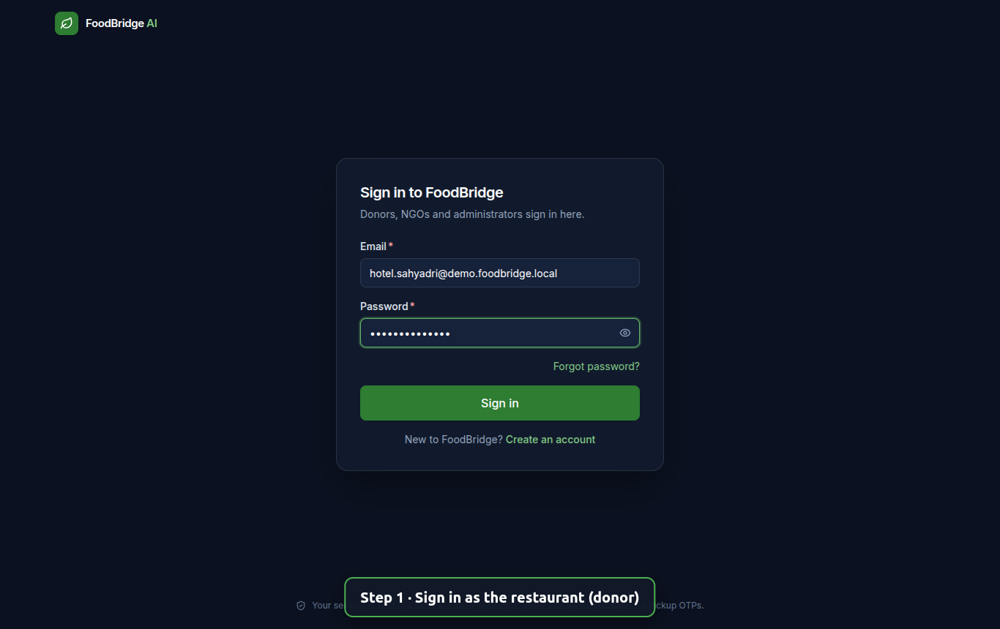

### Step 2 · Your home page: your food listings, pickups and reward points

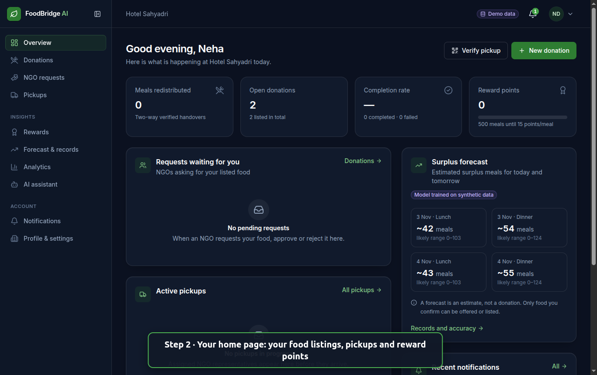

### Step 3 · You have 40 extra meals. Fill in what it is and how much, then publish. Listing is free.

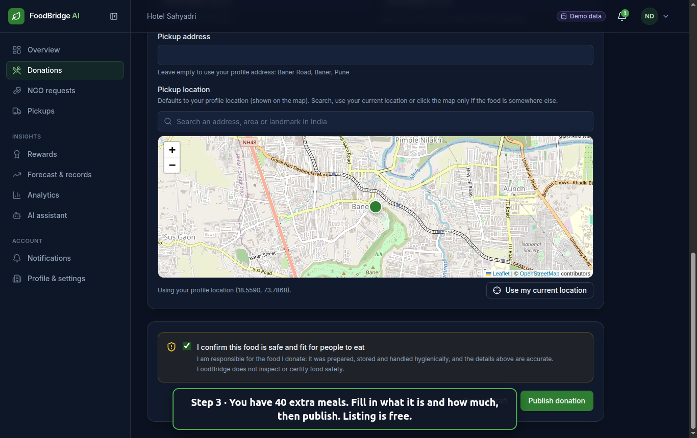

### Step 4 · FoodBridge AI ranks the best NGOs nearby (score out of 100, with reasons) and alerts them

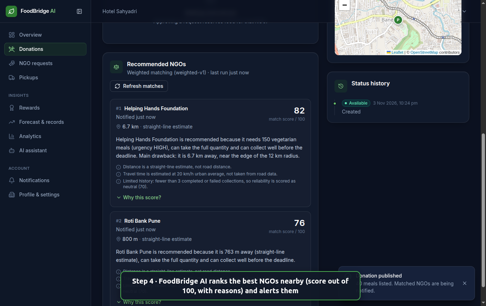

### Step 5 · An NGO (Helping Hands) asks for your 40 meals. You decide: Approve or Reject

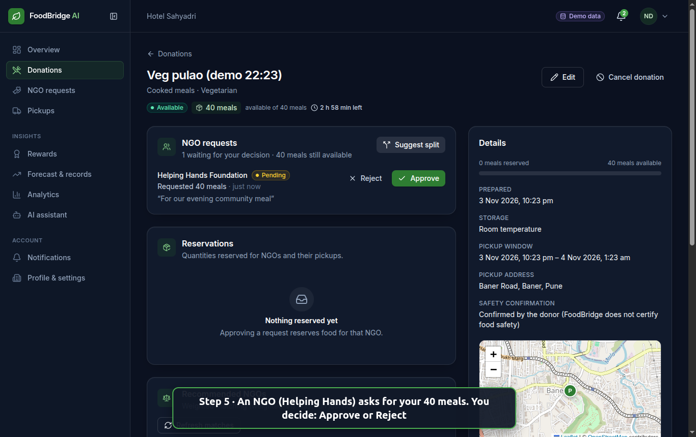

### Confirm the approval: these 40 meals are now reserved for this NGO only

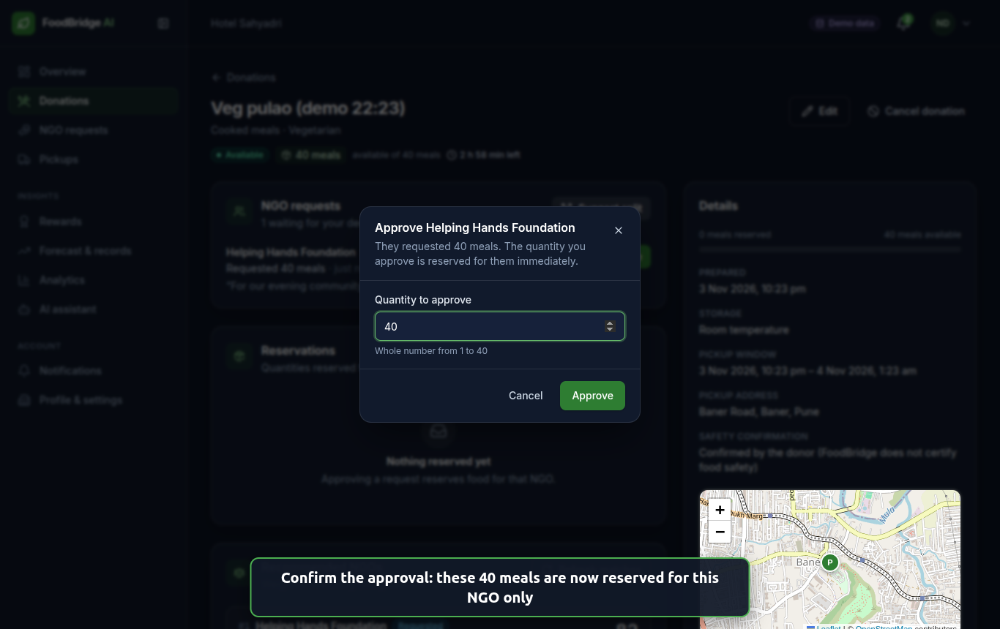

### Step 6 · The NGO's volunteer arrives. Scan their QR pass (or type its code) to check it is genuine

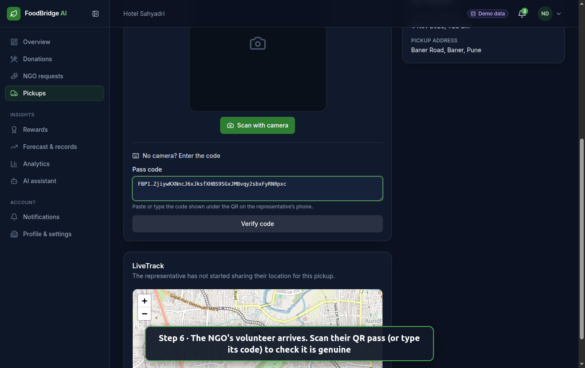

### Step 7 · Look at the volunteer's photo ID and tick that it matches

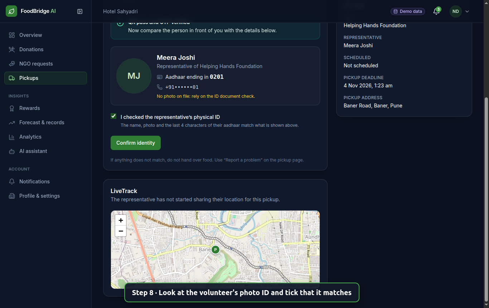

### Step 8 · Hand over the food and confirm how much you gave (40 meals)

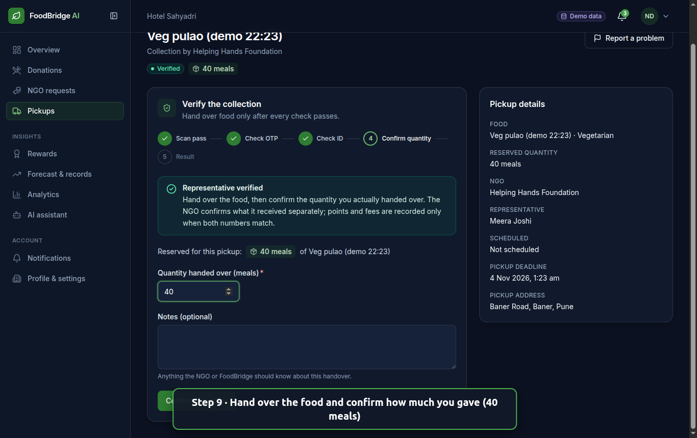

### Now FoodBridge waits for the NGO to confirm what it received

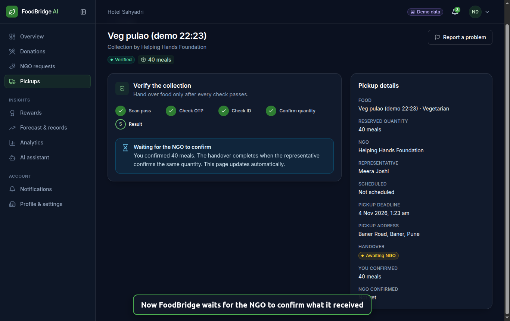

### Step 9 · The NGO confirmed 40 meals too, so the handover is complete

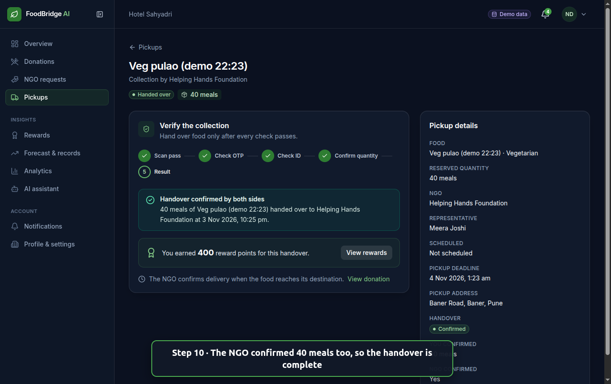

### Step 10 · You earn 10 points per meal: 40 meals = 400 points (15 per meal after 500 meals)

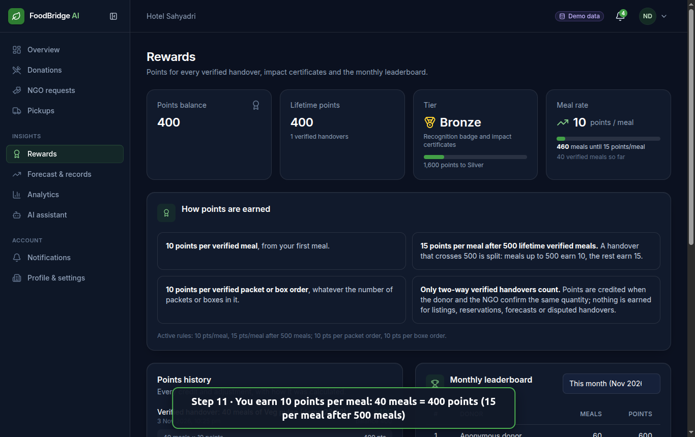
