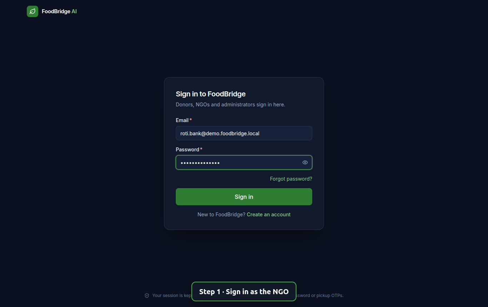
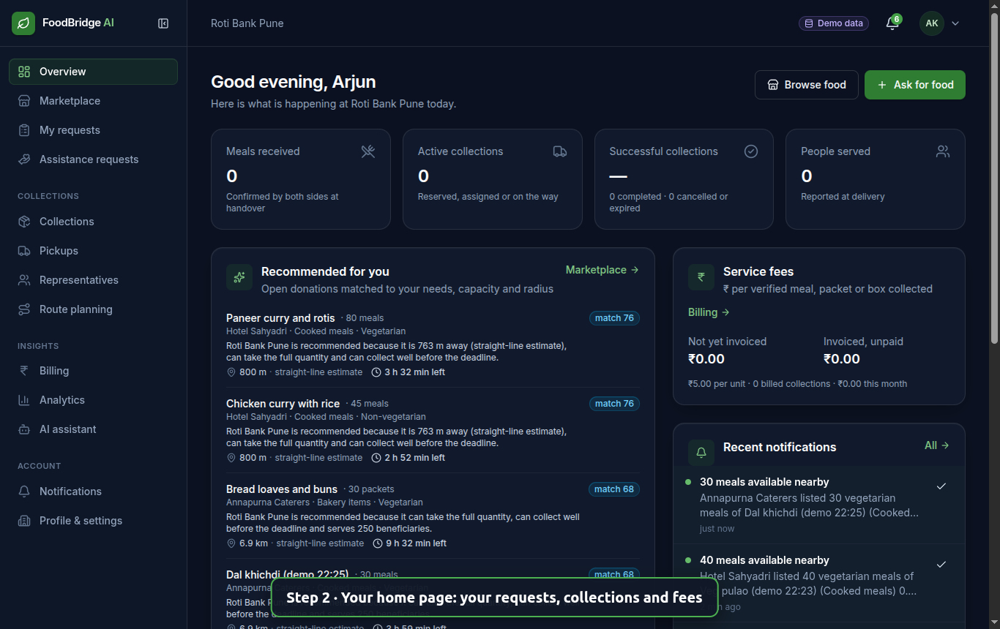
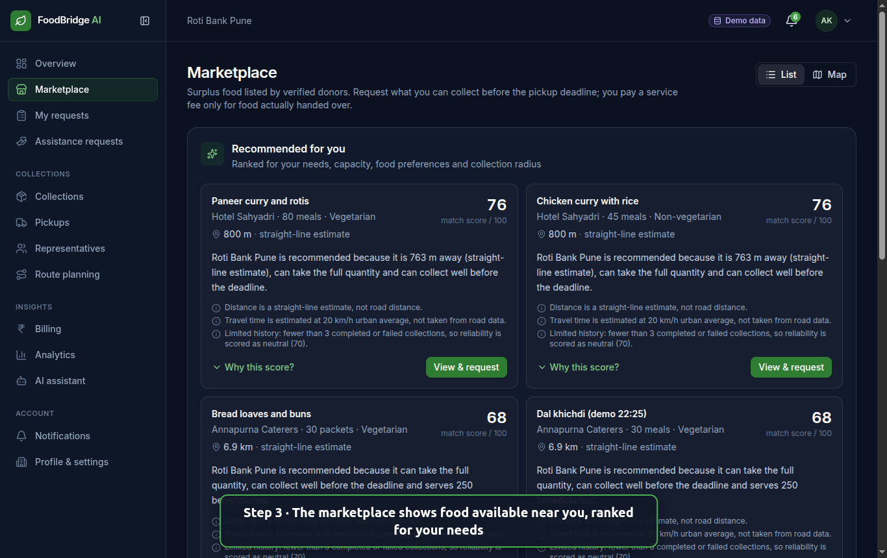
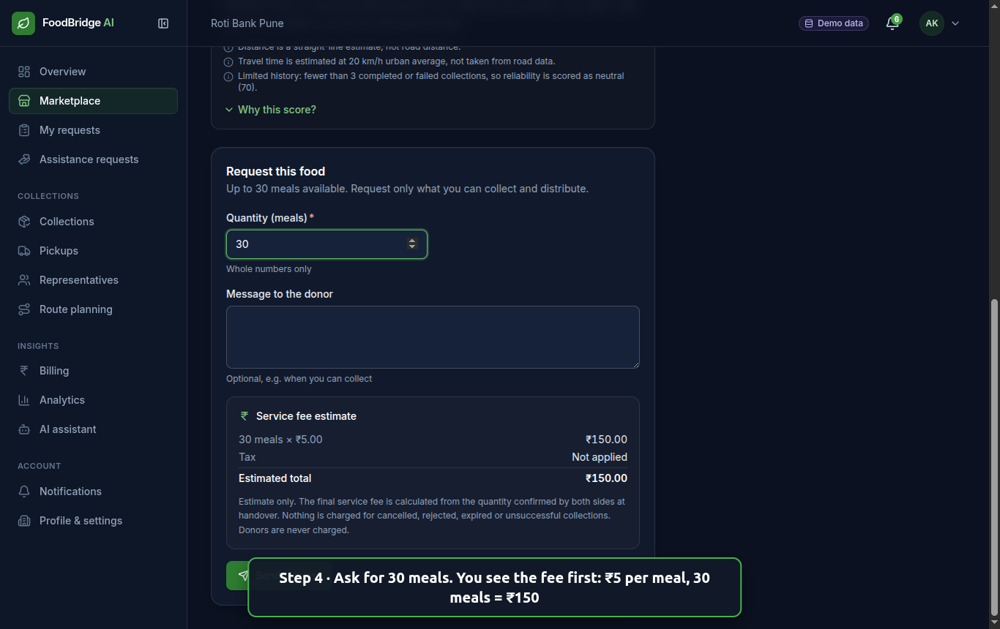

# NGO demo: Roti Bank Pune

Captured live from the running app. Each picture is one step; the caption at the bottom says what is happening.

### Step 1 · Sign in as the NGO

### Step 2 · Your home page: your requests, collections and fees

### Step 3 · The marketplace shows food available near you, ranked for your needs

### Step 4 · Ask for 30 meals. You see the fee first: ₹5 per meal, 30 meals = ₹150

