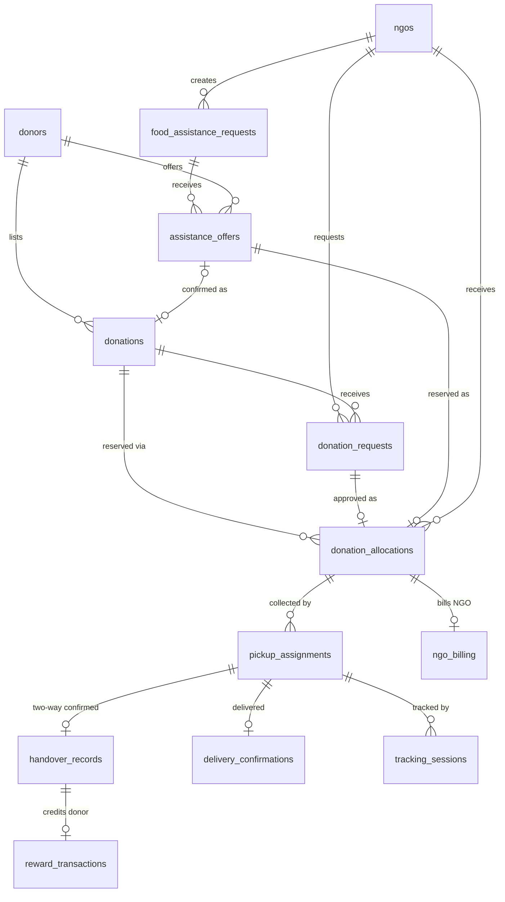
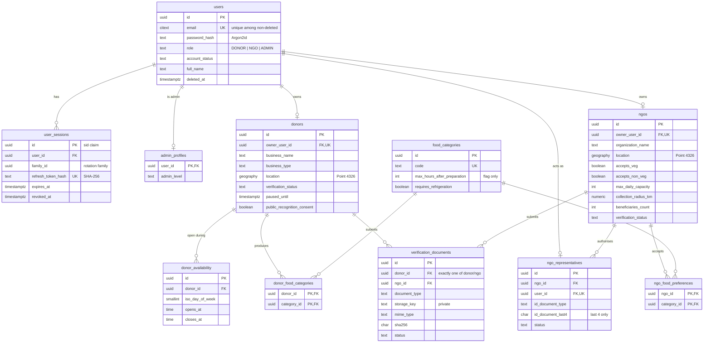
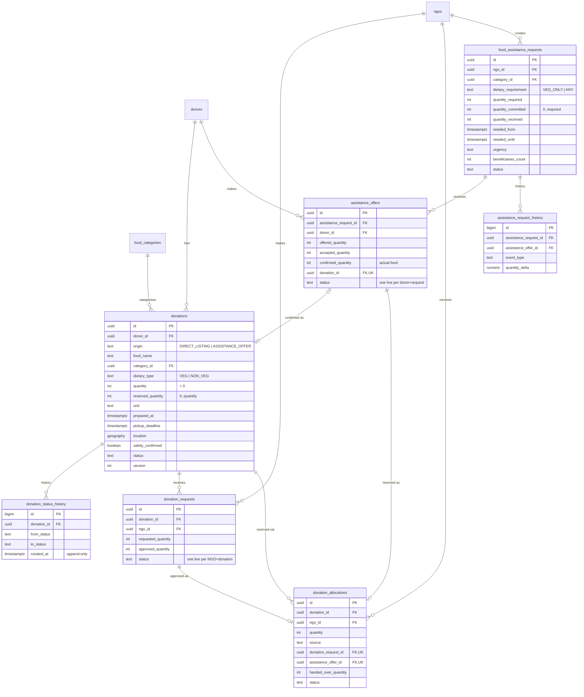
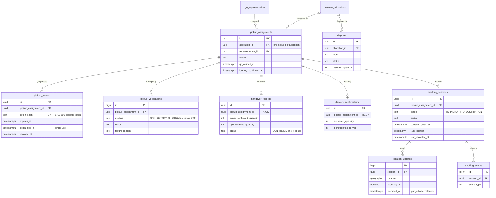
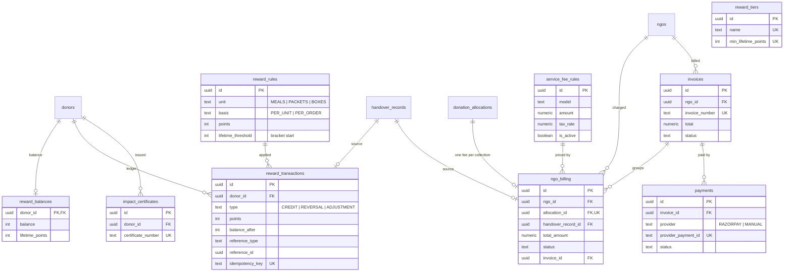
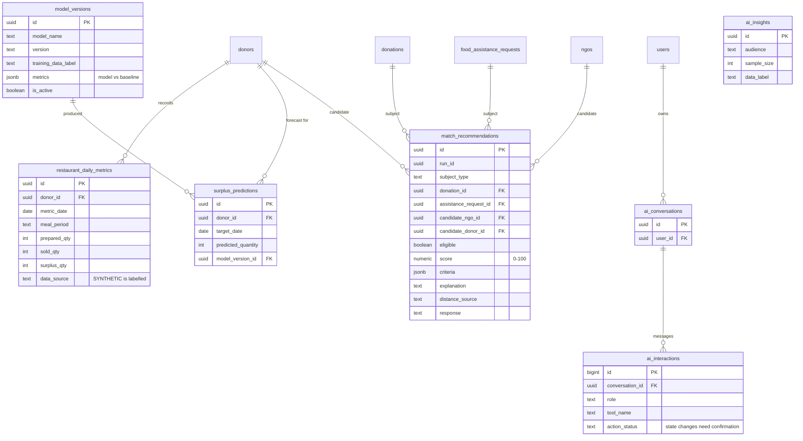
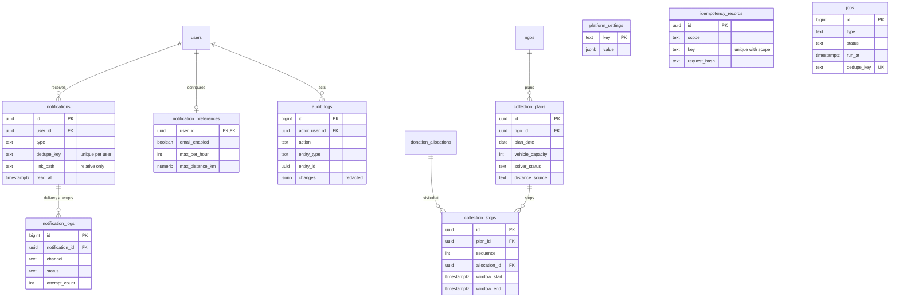

# FoodBridge AI: Entity-Relationship Diagrams

> **Status:** Implemented (53 tables, migrations 0001–0012). Column-level detail, constraints and rationale are in
> [DATABASE_DESIGN.md](DATABASE_DESIGN.md). These diagrams show keys and the main
> attributes only.
>
> To keep the diagrams readable, audit columns (`created_by`, `decided_by`,
> `verified_by`, …) that reference `users` are omitted. Every such column is a
> real foreign key in the schema.

Legend: `||--o{` one-to-many · `||--o|` one-to-zero-or-one · `}o--o{` many-to-many (via a join table).

---

## 1. Core flow overview

How the two discovery workflows converge on a single collection pipeline.

---

## 2. Identity and organisations (Phase 2)

---

## 3. Donations and NGO assistance (Phase 3)

---

## 4. Pickup, handover and tracking (Phases 7–8)

---

## 5. Rewards and billing (Phase 9)

---

## 6. AI, matching and assistant (Phases 5, 6, 11)

---

## 7. Notifications, collection planning and platform (Phases 1, 3, 10)

