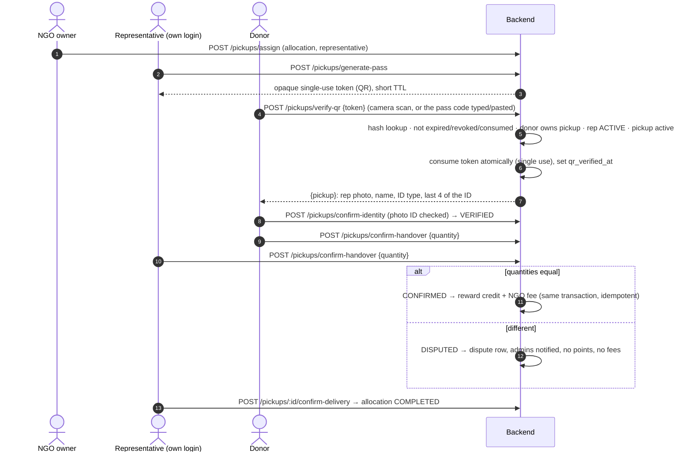

# Pickup Verification and Two-Way Handover

FoodBridge must be sure that the person collecting food is authorised by the NGO, and that both sides
agree on what was handed over. Points and NGO fees depend on it.
Implementation: [`backend/src/services/pickup.service.ts`](../backend/src/services/pickup.service.ts).

## 1. Flow

Verification has three steps: the donor verifies the representative's **QR pass**, then checks the representative's
**photo ID** (pickup becomes `VERIFIED`), then both sides **confirm the quantity** handed over.

## 2. QR pass security

| Control | Implementation |
|---|---|
| Content | `FBP1.` followed by 256 random bits (base64url). No personal data and nothing that can be guessed |
| Storage | Only the SHA-256 hash is stored (`pickup_tokens.token_hash`, unique) |
| Expiry | `pickup.qr_ttl_minutes` (default 30 min) |
| Single use | `UPDATE … SET consumed_at = now() WHERE … consumed_at IS NULL AND revoked_at IS NULL AND expires_at > now() RETURNING`. A concurrent second scan gets `TOKEN_CONSUMED` |
| One live pass | A partial unique index per pickup; generating a new pass revokes the old one |
| Ownership | The token must belong to a pickup of the scanning donor (`WRONG_DONOR`, and the token is not consumed) |
| Authorisation | Only the assigned `ACTIVE` representative can generate a pass, and only while the pickup is `ASSIGNED` or `EN_ROUTE` |
| Revocation | Unused passes are revoked on reassignment, pickup failure, allocation release or cancellation, and representative deactivation |
| Rejections | `422 QR_REJECTED` with `details.reason`: `TOKEN_NOT_FOUND` (forged or unknown), `WRONG_DONOR`, `TOKEN_REVOKED`, `TOKEN_CONSUMED` (reused), `TOKEN_EXPIRED`, `REPRESENTATIVE_INACTIVE`, `PICKUP_NOT_ACTIVE` |
| Trust | The QR content is never trusted: everything is re-validated on the server |
| Rate limiting | `verify-qr`: 30 requests per 15 minutes per user |
| Audit | Every attempt goes to `pickup_verifications` (result and reason; never the token). Failures also go to `audit_logs` (`pickup.qr_rejected`) |

## 3. Photo-ID check

After a successful scan the donor sees the representative's photo (when one is on file), name, ID document type and
the last 4 characters of the ID. The donor compares them with the person and their physical ID, ticks the check and
calls `POST /pickups/confirm-identity`:

- The QR pass must already be verified (`409 VERIFICATION_INCOMPLETE` otherwise).
- The representative must be `ACTIVE` (`403 REPRESENTATIVE_INACTIVE`).
- The pickup moves from `ASSIGNED` or `EN_ROUTE` to `VERIFIED` (`identity_confirmed_at` is set) and an
  `IDENTITY_CHECK` row is written to `pickup_verifications`.
- A database CHECK requires `qr_verified_at` and `identity_confirmed_at` for `VERIFIED`, `HANDED_OVER`, `IN_TRANSIT`
  and `DELIVERED`.

If anything does not match, the donor does not hand over food and reports a problem instead. Representatives still
need a phone number when they are created, as a contact detail only; nothing is sent to it during verification.

The OTP step was removed by the product owner on 2026-11-04 (migration `0012_remove_pickup_otp.sql`).
`pickup_verifications.method` still accepts `OTP` so historical log rows stay valid; new rows are `QR` or `IDENTITY_CHECK`.

## 4. Two-way confirmation

- Each side confirms once (`409 ALREADY_CONFIRMED`). Handover is only possible from the `VERIFIED` state, and an
  inactive representative is refused (`REPRESENTATIVE_INACTIVE`).
- Equal quantities → handover `CONFIRMED`, allocation `PICKED_UP` (`handed_over_quantity` = the confirmed
  quantity), pickup `HANDED_OVER`. Then **in the same transaction** the reward credit and the NGO fee are recorded,
  each with a unique idempotency key.
- Different quantities → handover, allocation and pickup become `DISPUTED`, a `QUANTITY_MISMATCH` dispute is created,
  admins and both parties are notified, and **no points or fees** are recorded.
- A database CHECK makes `CONFIRMED` impossible unless both quantities are present, equal and positive.

## 5. Disputes and failures

| Situation | Handling |
|---|---|
| Quantity mismatch | An admin resolves it with `CONFIRM_QUANTITY` (an agreed quantity, after which points and the fee are recorded with it) or `CANCEL_COLLECTION` (no points, no fee; the quantity is released and the request or offer, passes and tracking are unwound). A dispute can be resolved only once, even under concurrent requests |
| No-show | `report-failure`: the pickup becomes `FAILED`, unused passes are revoked, the allocation goes back to `RESERVED` for reassignment, and a `NO_SHOW` dispute is created when the donor reports it |
| Failure reported after one side confirmed a quantity | Not a failure: a `QUANTITY_MISMATCH` dispute is opened for an admin, so neither side can void the other's confirmation |
| Cancelling after the representative is verified | Refused for the donor and the NGO (`409 HANDOVER_IN_PROGRESS`); they confirm the real quantity or report the pickup as failed |
| Representative revoked mid-pickup | Their passes are revoked; QR scan, identity and handover steps refuse an inactive representative (`REPRESENTATIVE_INACTIVE`), and they lose NGO-wide access |
| Reassignment | Allowed until verification starts; the old pass and tracking session are ended |

GPS arrival never implies handover or delivery: both require explicit human confirmation.

Known gap: a handover confirmed by only one side has no timeout yet; it stays `VERIFIED` until the other side confirms,
reports a failure (which opens a dispute) or an admin intervenes.
