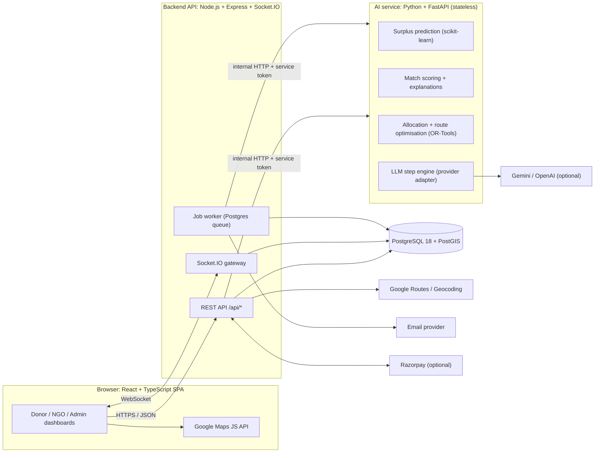
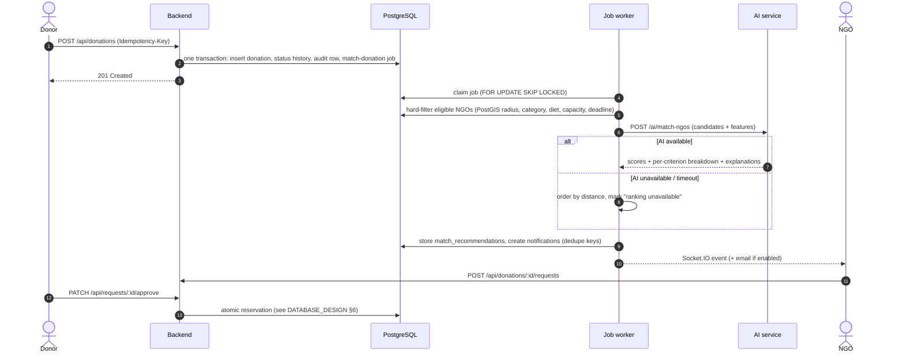
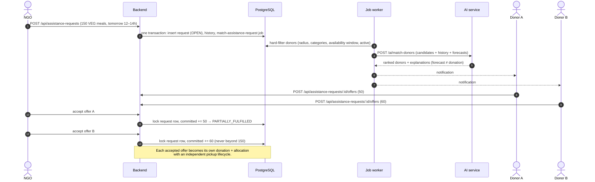
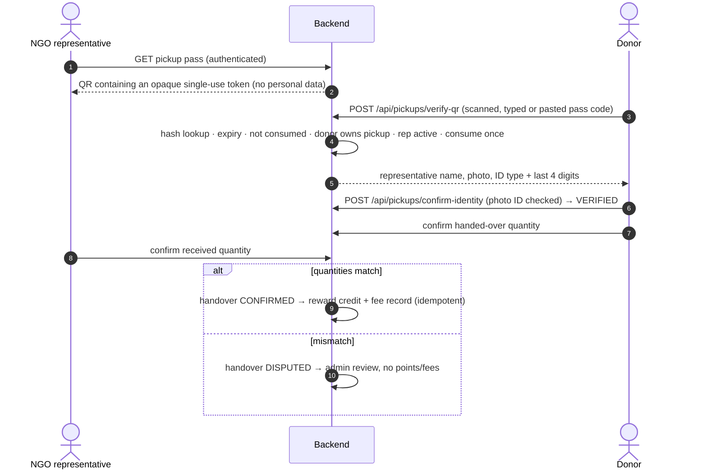
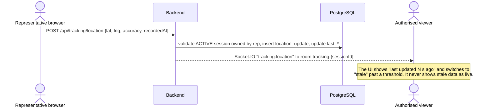

# FoodBridge AI: System Architecture

> **Status:** Implemented. This document describes the architecture as built; implementation status and test
> evidence are in [IMPLEMENTATION_PROGRESS.md](IMPLEMENTATION_PROGRESS.md) and [TESTING_REPORT.md](TESTING_REPORT.md).
> Related: [DATABASE_DESIGN.md](DATABASE_DESIGN.md) · [ER_DIAGRAM.md](ER_DIAGRAM.md)

---

## 1. Architectural principles

1. **The Node.js backend is the single authority.** Identity, roles, ownership,
   state transitions, reserved quantities, verification, reward points, fees
   and payments are decided only by backend business logic, inside PostgreSQL
   transactions.
2. **The AI service is stateless computation.** It receives the data it needs
   in each request and returns recommendations. It has no database access, holds
   no user credentials, and cannot change application state.
3. **Recommendations are never actions.** A prediction, ranking, allocation
   plan or LLM suggestion becomes a state change only after a human confirms it
   and the backend validates it.
4. **Degrade, never fake.** Optional dependencies (AI service, LLM, Google Maps,
   email, Razorpay) can fail or be unconfigured. Core donation workflows keep
   working and the UI labels what is unavailable, estimated or stale.
5. **PostgreSQL is the only stateful infrastructure.** It stores data, the job
   queue, the notification outbox and idempotency records. Redis or a message broker
   is added only when a measured need appears.
6. **Honest data.** Synthetic data, straight-line distance estimates, stale GPS
   positions and development-only behaviour are always labelled as such.
7. **Modular monolith plus one Python service.** No further microservices.

---

## 2. Component overview



### 2.1 Component responsibilities

| Component | Responsibilities | Explicitly **not** responsible for |
|---|---|---|
| **Frontend** (React, TS, Vite, Tailwind) | Role dashboards, forms with client-side validation (for UX only), maps, real-time updates, QR display/scan, assistant UI | Authorization, quantity checks, any trusted decision |
| **Backend** (Node 24, Express, TS) | Auth, RBAC + ownership checks, validation (Zod), state machines, transactional reservations, pickup verification, rewards ledger, billing, payments, notifications, audit logs, background jobs, Socket.IO, Google Maps server calls, orchestration of AI calls | ML model training, LLM provider calls |
| **AI service** (Python 3.12, FastAPI) | Surplus forecasting, match scoring and explanations, allocation optimisation, vehicle routing (VRPTW), single LLM inference steps, insight computation | Database access, authorization, executing reservations/payments/points |
| **PostgreSQL + PostGIS** | System of record, constraints as the last line of defence, geographic filtering, job queue, idempotency | n/a |

---

## 3. Authority boundaries

| Decision | Authority | Never decided by |
|---|---|---|
| Who the user is, and their role | Backend, from the verified session | Frontend input, AI service, LLM |
| Eligibility (hard filters) | Backend SQL (status, category, diet, capacity, radius, deadline) | AI service, LLM |
| Ranking score and explanation | AI service (deterministic weighted model); backend falls back to labelled distance order | LLM |
| Reserving quantity | Backend transaction with conditional updates and constraints | AI optimiser, LLM |
| Allocation plan across NGOs/donors | AI optimiser *recommends*; a human confirms; backend validates and executes | AI service alone |
| Pickup identity verification | Backend QR-pass validation **and** a human photo-ID check by the donor | GPS, AI |
| Handover / delivery quantities | Two-way human confirmation recorded by the backend | GPS arrival, AI |
| Reward points, service fees | Backend, after a two-way confirmed handover, idempotently | LLM, frontend |
| Food safety | Humans (donor confirmation, NGO judgement) | AI. It may only *flag* missing information |

---

## 4. Backend internal structure

```
HTTP request
  → middleware: request-id → security headers → CORS → body-size limit
               → rate limit → authenticate → authorize(role) → validate (Zod)
  → controller   (HTTP mapping only)
  → service      (business rules, state machines, transactions, audit, jobs)
  → repository   (parameterised SQL via node-postgres)
  → PostgreSQL
```

- **Data access:** `pg` (node-postgres) with parameterised SQL in repositories,
  not an ORM. Reservations depend on explicit transactions, row locks,
  conditional `UPDATE … RETURNING` and PostGIS functions, which are clearer in SQL.
- **State machines:** one module per lifecycle (donation, assistance request,
  offer, allocation, pickup) defines allowed transitions. Every transition writes
  history/audit rows in the same transaction. Invalid transitions return `409`.
- **Consistent API envelope:** `{ "data": … }` on success and
  `{ "error": { "code", "message", "details?", "requestId" } }` on failure.
- **Logging:** structured JSON (pino) with request IDs and a redaction list
  (passwords, tokens, QR payloads, API keys, payment data).

---

## 5. Key flows

### 5.1 Workflow A: donor creates a donation



### 5.2 Workflow B: NGO assistance request with partial fulfilment



### 5.3 Pickup verification and handover



### 5.4 LiveTrack location update



### 5.5 Assistant tool loop

The LLM never calls the database or backend directly. Each assistant turn runs
in this loop:

1. The backend sends the conversation and the role-filtered list of tool
   definitions to `POST /ai/assistant`.
2. The AI service makes **one** LLM call and returns either a final message or
   requested tool calls.
3. The backend checks each tool call: is the tool permitted for the user's
   role, and do the arguments pass validation? It then executes it through the
   same service layer as the REST API, as the authenticated user.
4. **Read-only tools** run immediately. **State-changing tools** (for example
   `create_assistance_request`) do not run. They return a pending action that the
   user must confirm in the UI.
5. Results, minimised to the fields needed, go back to step 1. A turn is capped
   at a fixed number of steps.
6. Structured result cards in the UI are rendered from tool results, not from
   LLM text, so displayed numbers are always real data.

If the LLM provider is unconfigured or fails, the assistant says it is unavailable.
Nothing else is affected.

---

## 6. Internal service communication (backend → AI service)

- HTTP/JSON with `Authorization: Bearer <INTERNAL_SERVICE_TOKEN>`, compared in
  constant time by FastAPI, and an `X-Request-Id` for correlated logs.
- In production the AI service is reachable only from the backend (private
  networking where the host supports it). The token is required in every
  environment.
- Default timeout 5 s (configurable). Because every AI endpoint is pure
  computation, a failed call is retried **once** with jitter. After that, the
  backend returns its core result with `ai.status = "unavailable"`.
- Request and response contracts are Pydantic models on the Python side and Zod
  schemas on the Node side, kept in step by contract tests.

---

## 7. Background jobs and reliable events

- The **`jobs` table** is the queue. Workers claim jobs with
  `SELECT … FOR UPDATE SKIP LOCKED`, so several backend instances are safe.
- **Transactional outbox:** jobs and notifications are inserted in the same
  transaction as the business change, so a crash after commit cannot lose an event.
- Retries use exponential backoff up to `max_attempts`. After that a job becomes
  `DEAD`, which admins can see. Failures are never silently dropped.
- Planned job types: `match-donation`, `match-assistance-request`,
  `deliver-notification` (email/push), `expire-donations`, `expire-requests`,
  `expire-offers`, `purge-location-history`, `purge-ai-interactions`,
  `cleanup-expired-tokens`.

---

## 8. Real-time (Socket.IO)

- The handshake authenticates with the access token. Each socket joins
  `user:{userId}`.
- Tracking rooms (`tracking:{sessionId}`) are joined only after the backend
  confirms the viewer is authorised: the donor of the allocation, the NGO, the
  assigned representative, or an admin (and admin views are audited).
- Notifications are **persisted first, then emitted**. Socket delivery is
  best-effort; clients refetch unread notifications on reconnect.
- Running several backend instances requires a Socket.IO adapter. The Postgres
  adapter avoids adding Redis. Until then, one backend instance is assumed.

---

## 9. Authentication and session design

| Aspect | Decision |
|---|---|
| Password hashing | Argon2id |
| Access token | JWT (HS256), 15 min, claims `sub`, `sid`, `role`; kept **in memory** in the SPA (not `localStorage`) |
| Refresh token | Opaque 256-bit random value, stored only as a SHA-256 hash in `user_sessions`, sent as an `httpOnly; Secure; SameSite=Strict` cookie scoped to `/api/auth`, rotated on every use |
| Refresh token reuse | Presenting an already-rotated token revokes the whole token family (theft detection) |
| Per-request check | Verify the JWT signature, then load the session and user. Revoked sessions and suspended accounts are rejected **immediately**, not when the token expires |
| CSRF | API calls carry the access token in the `Authorization` header (not a cookie). Cookie-based endpoints (refresh, logout) rely on SameSite=Strict plus an `Origin` check |
| Admin accounts | Created only by a server-side CLI command. There is no public admin registration |
| Rate limiting | Login, registration, refresh, QR verification, assistant |
| Lockout | Progressive lockout after repeated failed logins (`users.failed_login_attempts`, `locked_until`) |

**Deployment constraint:** the refresh cookie must be first-party, so in
production the frontend and API must be **same-site**. Either use subdomains of
one domain (e.g. `app.example.org` and `api.example.org`) or proxy `/api` through
the frontend host. Socket.IO authenticates with the access token in the handshake,
so it may connect to the API host directly.

---

## 10. Failure handling (degradation matrix)

| Failure | Behaviour | Mechanism |
|---|---|---|
| AI service down | Donations, requests, reservations and pickups work; rankings show "unavailable" and fall back to labelled distance order | Timeout + one retry + fallback path |
| Prediction unavailable | Forecast card shows "forecast unavailable", never a guessed number | Explicit `status` field in the response |
| LLM down or unconfigured | Assistant reports it is unavailable | Provider adapter returns a typed error |
| Google Routes down or unconfigured | Distances labelled "straight-line estimate"; ETA shown as unavailable | `distance_source` column, UI label |
| Invalid / expired / reused QR | Pickup rejected with a reason; attempt logged | Hash lookup + conditional consume + `pickup_verifications` |
| Concurrent reservations | Only available quantity is reserved; the loser gets `409` | Conditional `UPDATE` + CHECK constraints |
| Duplicate submission | Same response is replayed | `Idempotency-Key` + `idempotency_records` |
| Tracking disconnect | Last known position with its timestamp, labelled stale | `last_recorded_at` + staleness threshold |
| GPS permission denied | Explanation shown; tracking not started | Browser permission handling + `tracking_events` |
| Payment failure | Invoice stays unpaid / pending | Webhook-driven status, never assumed |
| Notification channel failure | Retried with backoff, then marked failed and visible | `notification_logs` + jobs |
| Donation passes deadline | Automatic transition to `EXPIRED` (or partial handling) | `expire-donations` job |
| Handover quantity mismatch | Handover `DISPUTED`; no points or fees until resolved | Two-way confirmation rule |

---

## 11. Configuration and secrets

- Configuration is validated at startup (Zod in Node, pydantic-settings in
  Python). Invalid or missing required config stops the process.
- Production guards: the backend refuses to start with `NODE_ENV=production` if the
  development email provider is selected, or if secrets are too short or still placeholders.
- Secrets live only in environment variables (`.env` locally, the platform
  secret store in production). `.env.example` documents every variable.

---

## 12. Local development topology

| Service | Host port | Notes |
|---|---|---|
| PostgreSQL + PostGIS (Docker) | `127.0.0.1:5433` | 5433 avoids a locally installed PostgreSQL on 5432 |
| Backend API | `5001` | Port 4000 was already in use on the development machine |
| AI service | `8001` | |
| Frontend (Vite) | `5173` | |

## 13. Target deployment topology

| Part | Target | Notes |
|---|---|---|
| Frontend | Vercel (or equivalent static host) | Must be same-site with the API (§9) |
| Backend | Render or Railway web service | Runs migrations on release; health check `/api/health` |
| AI service | Render or Railway private service | Not publicly exposed where possible; health check `/ai/health` |
| Database | Managed PostgreSQL with PostGIS | Separate migration role and least-privilege application role |

---

## 14. Decision log

| # | Decision | Alternatives considered | Reason |
|---|---|---|---|
| D1 | Modular monolith backend plus one Python service | Microservices per domain | Team size and scope; transactions span domains |
| D2 | Postgres-backed job queue and outbox | Redis/BullMQ, RabbitMQ | No extra infrastructure; transactional enqueue; meets current load |
| D3 | AI service stateless, no DB access | AI reads DB with a read-only role | Prevents any authorization bypass; simpler to test and deploy |
| D4 | Hard filters in backend SQL; scoring in the AI service | All matching in Python, or all in Node | Eligibility is a business rule tied to authorization and PostGIS; scoring is computation. No duplicated logic: the fallback is a plain distance sort, not a second scorer |
| D5 | Google Maps server calls from the backend only; AI service receives matrices | AI service calls Google | One place for keys, quotas and the "estimated vs road distance" labelling |
| D6 | LLM step engine in Python; tools executed by the backend | LLM fully in Node, or Python calls back into Node with user tokens | Keeps the provider adapter in the AI service (per spec) while identity never leaves the backend |
| D7 | Both workflows converge on `donation_allocations` | Separate pickup pipelines per workflow | One pickup, verification, tracking, reward and billing implementation |
| D8 | `pg` with SQL repositories | Prisma, TypeORM | Explicit locking, conditional updates, PostGIS |
| D9 | Access token in memory plus rotating refresh cookie | Tokens in `localStorage` | XSS cannot read a long-lived credential |
| D10 | TypeScript 6.0.x | TypeScript 7.x (native compiler) | typescript-eslint currently supports TypeScript below 6.1; revisit later |
| D11 | PostgreSQL 18 + PostGIS 3.6; UUID v4 keys via `gen_random_uuid()` | Native `uuidv7()` (PG 18 only) | Keeps migrations portable to managed providers still on PG 16/17 |
| D12 | Python 3.12 managed by `uv` | System Python 3.10 | Current numpy, pandas and scikit-learn need newer Python; matches the Docker image |
| D13 | Rewards and fees recorded at **two-way confirmed handover** | At delivery confirmation | Spec §19/§20 ("after verified handover"); the donor's reward does not depend on the NGO's later steps |

## 15. Product decisions (resolved 2026-11-03)

| Question | Decision | Where implemented |
|---|---|---|
| Units | `MEALS`, `PACKETS`, `BOXES` only; whole numbers | DB CHECKs, validators |
| Reward formula | 10 points per verified meal; 15 per meal after 500 lifetime verified meals (a handover crossing 500 is split); 10 points per verified packet or box order | `reward_rules`, `domain/rewards.ts` ([REWARD_SYSTEM.md](REWARD_SYSTEM.md)) |
| Service fee | ₹5 per verified meal, packet or box; GST configurable, separate and off by default (professional validation required) | `service_fee_rules`, `billing.tax`, `domain/fees.ts` ([NGO_BILLING.md](NGO_BILLING.md)) |
| Pickup verification | QR pass, then the donor's photo-ID check, then two-way quantity confirmation; no code is sent to the representative's phone (product owner decision, 2026-11-04) | `pickup.service.ts` ([PICKUP_VERIFICATION.md](PICKUP_VERIFICATION.md)) |
| Maps in the browser | OpenStreetMap (Leaflet) by default; Google Maps JS when a browser key is configured | frontend `MapView` |

## 16. Deviations from the master prompt

| Item | Deviation | Reason |
|---|---|---|
| Matching location | Hard eligibility filters run in the backend (PostGIS); weighted scoring runs in the AI service | Eligibility is a business rule tied to authorisation; avoids duplicated logic |
| Google road data | Server-side Google calls are made by the backend only; the AI service receives matrices | One place for keys and for "estimate vs road" labelling |
| Dockerfiles | All Dockerfiles live in `deployment/docker/` (not inside each service folder) | User instruction: deployment assets live in `deployment/` |
| Browser push | In-app, Socket.IO, email and in-tab browser notifications are implemented; background Web Push is not | Requires VAPID keys and a service worker; documented as future work |
